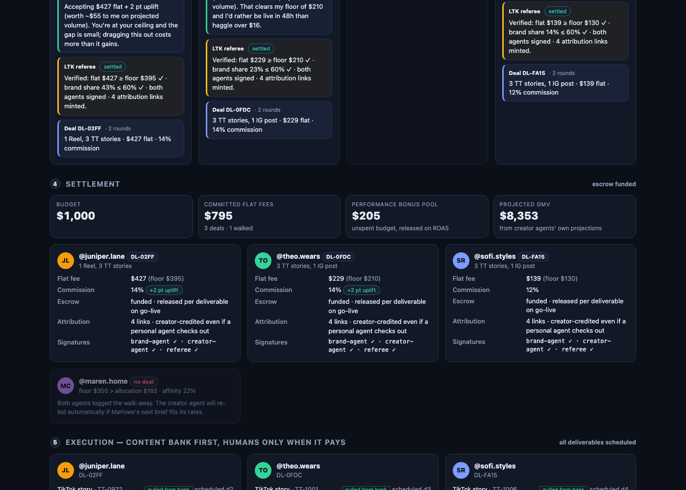
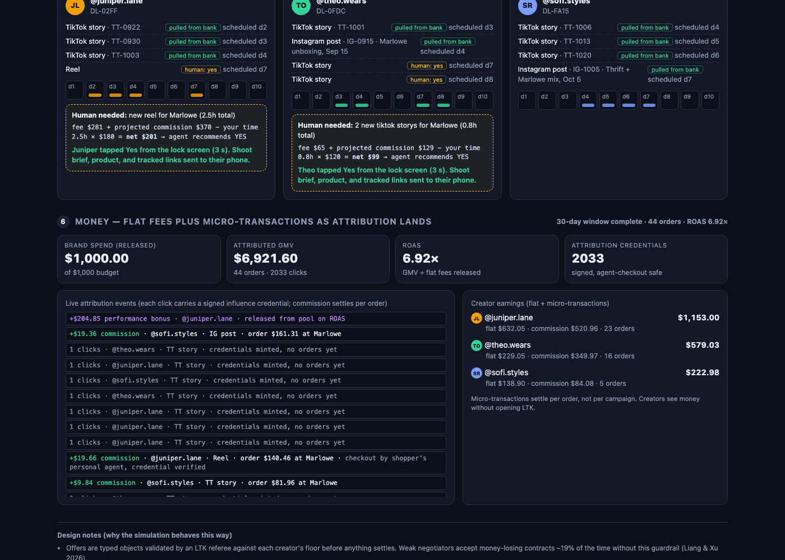
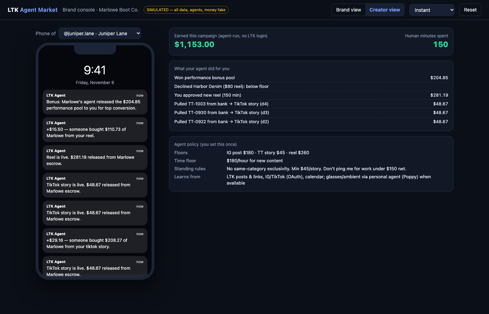

# LTK Agent Market — simulated prototype

A single-file, fully simulated prototype of **agent-to-agent creator commerce**: a brand deploys a budget, creator agents respond with packages, the agents negotiate under an LTK referee, settle, execute from each creator's content bank (asking the human only when it pays), and money arrives as flat fees plus per-order micro-transactions.

NOTES! 
1. Everything is fake intentionally for this prototype : creators, content, clicks, orders, dollars. There is no backend, no network call, no login. Open `index.html` in a browser.
2. This is buildable with real data.



## The idea in one paragraph

Every LTK creator gets an agent that is their business partner, brand negotiator, and operations staff. Every brand gets an agent that spends its budget. A creator should never have to log in to LTK again: their agent secures deals, pulls from existing content, asks for new content only when the expected value beats the creator's time, answers follower questions, and collects every micro-transaction before attribution is lost. This prototype shows the brand's point of view of that market, with a toggle to any creator's phone.

## Run it

```
open index.html
```

Or serve the folder with anything static. No build step, no dependencies.

### Controls

| Control | What it does |
|---|---|
| **Budget** | Dollars the brand agent may commit. Allocation across creators scales with it; lower it and more creator agents walk. |
| **Brief** | Natural language. The brand agent parses audience, channels (`instagram`, `tiktok`), `reel` requirement, deadline (`N days`), and whether to weight brand affinity. |
| **Deploy budget** | Runs the six scenes. |
| **Speed** | Normal (demo pacing), Fast, Instant. |
| **Brand view / Creator view** | Creator view shows a chosen creator's lock-screen notifications, earnings, human minutes spent, and the agent policy they set once. |
| **Reset** | Clears state; the simulation is seeded so the same inputs reproduce the same run. |

### URL parameters

| Param | Example | Effect |
|---|---|---|
| `autorun` | `?autorun=1` | Deploy on load |
| `speed` | `&speed=0.35` | `1` normal, `0.35` fast, `0` instant |
| `budget` | `&budget=1500` | Pre-fill budget |
| `view` | `&view=creator` | Switch to Creator view after the run |

Example demo link: `index.html?autorun=1&speed=0.35`

## The six scenes

1. **Mandate.** The brief becomes a structured, machine-checkable mandate: budget, audience, affinity weight, channels, reel requirement, deadline, max share per creator, walk-away threshold, escrow terms.
2. **Creator agents respond.** Four creator agents with different audiences, engagement, brand affinity (prior orders of this brand), content banks, and hourly floors each propose a package. Packages are sized so their *floor* fits the brand's allocation; the *ask* is anchored above it. Each deliverable is tagged `from bank` or `needs human`.
3. **Negotiation.** Four parallel threads. Offers are typed objects. The **LTK referee** blocks any brand offer below a creator's verified floor before the creator agent ever sees it. The brand agent trims packages that cannot fit, trades flat fee for commission uplift with high-affinity creators, and walks away with a logged reason when floors exceed allocation. Creator agents concede by a configured patience and close when the counterpart is at its ceiling and the gap is small.
4. **Settlement.** Deals carry floor verification, max-share check, signatures from both agents and the referee, escrow terms, and minted attribution links. Unspent budget becomes a performance bonus pool.
5. **Execution.** Bank assets are scheduled with zero human involvement. New content triggers one batched lock-screen ask per content type with the expected-value math shown (fee + projected commission − hours × hourly floor).
6. **Money.** A 30-day ledger: flat fees release per deliverable on go-live, commission lands per attributed order (some flagged as checkout by the shopper's personal agent with a verified credential), ROAS and credential counts update live, and the bonus pool releases to the top converter.





## What is simulated vs. what the engine does

The negotiation is not a script. It is a small rule-based engine; change the budget or brief and the outcome changes. See [docs/DESIGN.md](docs/DESIGN.md) for the rules, the parameters, and where each rule comes from in the research.

Synthetic: creator profiles, content banks, click and order arrivals, payments, the phone notifications. Nothing touches LTK data, Instagram, TikTok, or money.

## Why it is built this way

The design follows five findings from recent agentic-commerce research. Short version:

- **Typed offers plus a referee.** Weaker negotiating models accept money-losing contracts in roughly one in five negotiations without automated profit verification.
- **Parallel, many-to-one negotiation.** More counterparties produce faster and better deals; the buyer side is structurally weaker, so the brand agent follows an explicit allocation strategy.
- **Same policy and patience on both sides.** Provider identity and prompted patience, not raw capability, decide who captures surplus. LTK standardizes this so creators are not out-negotiated.
- **Content bank first; humans only when it pays.** The creator agent's job is to protect the creator's time.
- **Attribution credentials per click.** Commission must survive a purchase completed by a personal agent rather than a human.

Full citations in [docs/DESIGN.md](docs/DESIGN.md). A step-by-step talk track is in [docs/DEMO_SCRIPT.md](docs/DEMO_SCRIPT.md).

## Roadmap (not built)

- Replace the four synthetic creators with real profiles via the LTK Athena data lake (followers, affinity from orders, bank from post history). Data-layer change only.
- Expose the creator agent and brand agent as an MCP server; mount in ChatGPT (Apps SDK, custom UI), Glean (as MCP host, for internal ops), and Claude/Cursor for development.
- Implement the Personal Agent Protocol (Poppy) company endpoint so external personal agents (Meta, OpenAI, Instinct) can reach creator agents.
- Real negotiation runtime on frontier models behind the same referee and typed-offer contract.
- Live attribution credentials and escrow.

## Layout

```
index.html              the whole prototype (HTML, CSS, JS)
docs/DESIGN.md          engine rules, parameters, research mapping
docs/DEMO_SCRIPT.md     five-minute walkthrough
docs/screenshots/       captures from an instant-speed run
```
