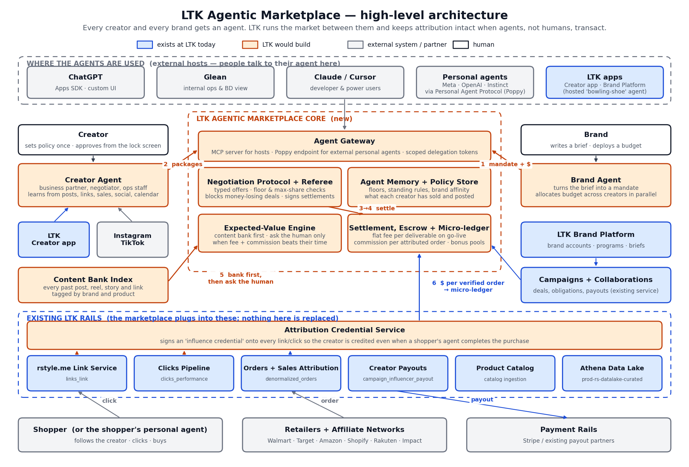

# LTK Agentic Marketplace — high-level architecture

**Blue** = exists at LTK today. **Orange** = LTK would build. **Gray** = external hosts, platforms, and partners. Numbers on the arrows match the six scenes in the prototype (mandate → packages → negotiation → settlement → execution → money).

Regenerate the diagram with `python docs/architecture_diagram.py` (needs matplotlib).

## How to read it in one minute

1. A **brand** writes a brief and deploys a budget in whatever tool they already use (ChatGPT, Glean, the LTK Brand Platform). Their **Brand Agent** turns it into a structured mandate and hands it to LTK through the **Agent Gateway**.
2. Every eligible **Creator Agent** answers with a package built from that creator's **Content Bank** first, priced against floors the creator set once.
3. Agents negotiate through the **Negotiation Protocol**. The **Referee** blocks any offer under a creator's floor, enforces the brand's max-share rule, and signs the final deal.
4. **Settlement** funds escrow and mints one attribution link per deliverable through the existing **rstyle.me Link Service**, with an **Attribution Credential** attached.
5. The Creator Agent schedules bank content immediately and asks the human only when the **Expected-Value Engine** says the fee plus projected commission beats their time.
6. Shoppers (or their personal agents) click and buy through the existing **Clicks Pipeline** and **Orders + Sales Attribution**. The credential proves which creator influenced the order even if an agent completed checkout. Commission flows to the **Micro-ledger** per order and out through existing **Creator Payouts**.

## What already exists at LTK (blue)

| Diagram label | Real LTK system or data | Where it shows up in the data lake |
|---|---|---|
| LTK apps (Creator app, Brand Platform) | LTK Creator app; LTK Brand Platform (BP) | `influencer_account_profile`, `brand_account`, `brand_subscription`, `bp_*` |
| LTK Brand Platform | Brand accounts, advertiser programs, subscriptions | `brand_account`, `brand_advertiser_program`, `brand_affiliate_network` |
| Campaigns + Collaborations | Campaigns / Collaborations service | `campaign_campaign`, `campaign_collaboration`, `campaign_obligation`, `collaborations_service_*` |
| rstyle.me Link Service | Affiliate link creation and redirect | `links_link`, `hyperlink_url` on clicks tables |
| Clicks Pipeline | Click tracking and performance aggregation | `clicks_clicks_base`, `clicks_performance` |
| Orders + Sales Attribution | Order ingestion from affiliate networks and attribution to creator, post, link, campaign | `denormalized_orders`, `campaign_sales_attribution` |
| Creator Payouts | Campaign and commission payouts | `campaign_influencer_payout`, `campaign_influencer_payout_method` |
| Product Catalog | Catalog ingestion, price-drop and low-stock signals, retailer search rank | `prod_ltk_product_catalog_bronze.catalog_analytics`, `retailers_gmv`, `retailers_search_rank` |
| Athena Data Lake | Curated and bronze data lake queried via Athena | `prod-rs-datalake-curated`, `prod_ltk_datalake_bronze` |
| Leaderboards, likes, channels (not drawn) | Supporting signals for creator ranking and engagement | `leaderboard_golden_*`, `ltk_likes_service_likes`, `channel_channel` |

Chatbot V1 (brand-account memory, flat-rate pricing) was approved in the May 22, 2026 deep dive and is in flight; it is a natural first host for the Brand Agent inside the Brand Platform.

## What LTK would build (orange)

| Component | What it does | Notes |
|---|---|---|
| **Agent Gateway** | Single front door for every host. Exposes creator and brand agents as an MCP server (ChatGPT Apps SDK, Glean, Claude, Cursor) and as a Personal Agent Protocol (Poppy) company endpoint for external personal agents. Issues and verifies scoped delegation tokens. | Poppy draft 0.3 defines `/.well-known/poppy.json`, OAuth sign-in, and company-defined scopes. |
| **Creator Agent** | Hosted runtime per creator: negotiates, schedules, answers follower questions, collects money. Bring-your-own agents connect through the gateway and get the same business logic. | "Bowling-shoe" by default, portable by design. |
| **Brand Agent** | Hosted runtime per brand: parses briefs into mandates, allocates budget across creators in parallel, trades flat fee for commission uplift, walks away with a logged reason. | Extends Chatbot V1. |
| **Negotiation Protocol + Referee** | Typed offer objects (deliverables, flat, uplift, exclusivity, deadline). Deterministic validation against floors and mandate rules before any offer reaches the counterpart. Signs settlements. | Removes the failure mode where a weak agent signs a money-losing deal. |
| **Agent Memory + Policy Store** | Per-creator floors, standing rules, hourly time floor, brand affinity, history of what sold. Per-brand mandates and approval thresholds. | Derived from existing tables; new write path for policy. |
| **Expected-Value Engine** | Content bank first; batched human asks only when fee + projected commission beats the creator's time at their floor. | Projections from `clicks_performance` and `denormalized_orders` by creator × brand. |
| **Content Bank Index** | Every past post, reel, story and link indexed by brand and product so agents can fulfill deliverables without new shoots. | Built from `post_ltk_post`, `links_link`, and creator-authorized Instagram/TikTok reads. |
| **Settlement, Escrow + Micro-ledger** | Escrow per deal, flat fee released per deliverable on go-live, commission credited per attributed order, bonus pools released on performance. | Settles into existing payouts; new ledger grain is per order, not per campaign. |
| **Attribution Credential Service** | Signs an influence credential onto each link and click so commission is credited when a shopper's personal agent, not a human, completes the purchase. | The defensive piece: protects the affiliate model as agents take over checkout. |

## External (gray)

| Label | Who | Role |
|---|---|---|
| ChatGPT, Glean, Claude / Cursor | OpenAI, Glean, Anthropic, Cursor | Hosts where a person talks to their agent. Mount the LTK MCP server; ChatGPT Apps SDK gives a custom UI. |
| Personal agents | Meta (Muse), OpenAI (Dots), Instinct | Reach LTK agents through Poppy. Also the sanctioned route for ambient context such as Meta glasses. |
| Instagram, TikTok | Meta, ByteDance | Creator-authorized reads to feed the content bank and learn posting behavior. |
| Shopper or shopper's personal agent | Consumers | Click, buy, increasingly via an agent. |
| Retailers + affiliate networks | Walmart, Target, Amazon, Shopify merchants, Rakuten, Impact | Where orders happen and where commission originates. |
| Payment rails | Stripe and existing payout partners | Move money. |

## Build order suggestion

1. **Attribution Credential Service** and **Agent Gateway (MCP)** first; everything else depends on being credited when agents transact and on being reachable from the hosts people already use.
2. **Brand Agent** on top of Chatbot V1, plus **Negotiation Protocol + Referee**, using the prototype's typed-offer contract.
3. **Creator Agent**, **Content Bank Index**, and **Expected-Value Engine** for a tiered-commission cohort of creators.
4. **Settlement + Micro-ledger**, then the **Poppy endpoint** for external personal agents.
